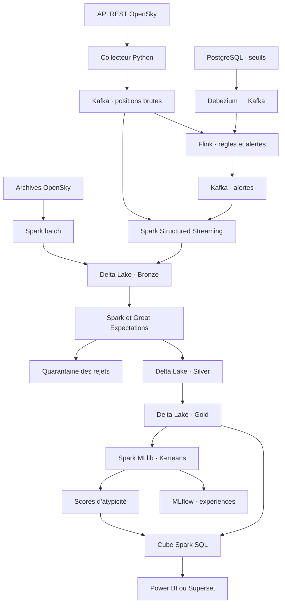

##AeroWatch : Plateforme décisionnelle de suivi du trafic aérien

AeroWatch est une plateforme décisionnelle de suivi du trafic aérien développée dans le cadre du module **Processus Décisionnel Big Data**. Elle combine les archives OpenSky et les positions récentes collectées via l’API pour comparer le trafic observé par zone et par période, et repérer des segments de trajectoire atypiques.

**État du projet** · Dépôt en cours d’initialisation. Ce README décrit l’architecture cible et les fonctionnalités prévues.

## Fonctionnalités prévues

- Afficher sur une carte la dernière position disponible par appareil, avec l’altitude, la vitesse, le cap et l’heure de la mesure.
- Comparer le nombre d’appareils distincts observés, la vitesse moyenne et la distribution des altitudes par zone et période.
- Modifier un seuil d’alerte dans PostgreSQL et appliquer la nouvelle règle dans Flink sans redémarrer le traitement.
- Regroupe r les segments de trajectoire avec K-means et présenter les segments atypiques à examiner.
- Suivre la fraîcheur des données, le débit, les rejets et les erreurs de collecte dans Grafana.

La démonstration en direct portera sur une zone géographique. Le Maroc est le premier choix, sous réserve de la couverture observée lors des premiers tests.

## Architecture

AeroWatch suit une **architecture Lambda**. Spark traite les archives par lots, tandis que Kafka alimente les traitements en quasi temps réel. Les observations des deux chemins sont réconciliées dans Delta Lake.

| Couche | Contenu |
| --- | --- |
| **Bronze** | Archives et réponses OpenSky brutes, avec provenance et horodatages disponibles. Les événements d’alerte sont conservés dans une table distincte. |
| **Silver** | Observations normalisées en UTC, contrôlées avec Great Expectations et dédupliquées sur l’identifiant de l’appareil et l’heure de position. Les rejets sont enregistrés avec leur motif. |
| **Gold** | Observations batch et streaming réconciliées, indicateurs par zone et période, segments de trajectoire et résultats ML. |

**Airflow** orchestre les traitements batch, la qualité, les calculs Gold et l’entraînement. **Grafana** supervise le pipeline. **Docker Compose** sert au déploiement local. **Power BI** est le choix envisagé pour le tableau de bord, avec **Superset** comme solution locale si la connexion Power BI ne peut pas être validée.

## Détection de segments atypiques

Le modèle **K-means** de Spark MLlib regroupera des segments à partir de la vitesse, de l’altitude et des variations de cap. La distance au centre du groupe servira de score d’atypicité. Le modèle sera évalué sur une période postérieure à l’entraînement, à l’aide du score de silhouette et de l’examen de segments représentatifs. Les expériences seront enregistrées dans MLflow.

## Feuille de route

| Sprint | Objectif | Résultat attendu |
| --- | --- | --- |
| **1 · Semaine 2** | Cadrage et ingestion batch | Un fichier historique est chargé dans Bronze avec sa provenance. |
| **2 · Semaine 2** | Ingestion quasi temps réel | Une observation OpenSky est traçable depuis Kafka jusqu’à Bronze. |
| **3 · Semaine 3** | Qualité et alertes dynamiques | Les rejets sont isolés et Flink applique un nouveau seuil transmis via Debezium. |
| **4 · Semaine 3** | Réconciliation et premiers KPI | Un KPI du tableau de bord concorde avec Spark SQL et le rejeu préserve les compteurs. |
| **5 · Semaine 4** | Machine Learning et exploitation | Les résultats du modèle sont visibles dans MLflow. Le DAG Airflow s’exécute et Grafana affiche les métriques du flux. |
| **6 · Semaine 4** | Recette et soutenance | La chaîne complète est démontrable en direct et avec des observations enregistrées. |

## Exécution locale

Le démarrage local est prévu avec **Docker et Docker Compose**. Les commandes seront documentées dans cette section dès que la configuration Compose aura été ajoutée et testée. Les identifiants OpenSky resteront hors du dépôt. Un scénario de rejeu à partir de réponses OpenSky enregistrées permettra de tester le flux si l’API est indisponible.

## Équipe

- Farah **HANTI**
- Mohammed **ESSOULAIMANI**
- Ahmed **MASBAH**

## Sources des données

- [OpenSky REST API](https://openskynetwork.github.io/opensky-api/rest.html) pour les positions récentes.
- [OpenSky Scientific Datasets](https://opensky-network.org/data/scientific) pour les observations historiques.
